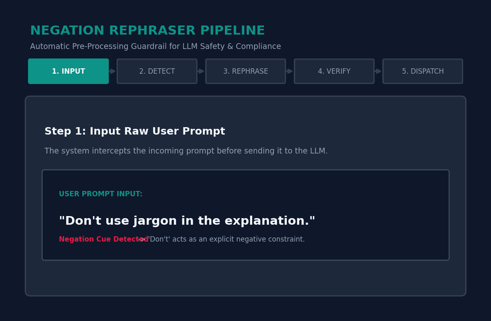

# Rephraser pre-processor

This package implements the three-stage negative-to-positive constraint
pre-processor pipeline: negation detection → candidate generation →
semantic verification.

### Flow


### Demo video
<a href="https://youtu.be/Xpq4oY3GHPg" target="_blank">
  
</a>

---

## Live Hosted Service (Google Cloud Run)

The service is currently deployed and live on Cloud Run:

- **Base URL:** `https://negation-rephraser-887349447313.europe-west1.run.app`
- **Health Check:** `https://negation-rephraser-887349447313.europe-west1.run.app/health`
- **Rephrase API:** `https://negation-rephraser-887349447313.europe-west1.run.app/rephrase`

### Quick Test with Live API

**PowerShell:**
```powershell
# Check health
Invoke-RestMethod -Uri "https://negation-rephraser-887349447313.europe-west1.run.app/health"

# Test rephrasing
Invoke-RestMethod -Method Post -Uri "https://negation-rephraser-887349447313.europe-west1.run.app/rephrase" `
  -ContentType "application/json" `
  -Body '{"text":"Don'\''t use jargon in the explanation."}'
```

**cURL:**
```bash
# Check health
curl https://negation-rephraser-887349447313.europe-west1.run.app/health

# Test rephrasing
curl -X POST https://negation-rephraser-887349447313.europe-west1.run.app/rephrase \
  -H "Content-Type: application/json" \
  -d '{"text":"Don'\''t use jargon in the explanation."}'
```

---

## Quick start (Local Development)

1. Create a Python venv and install requirements:

```powershell
python -m venv .venv
.\.venv\Scripts\Activate.ps1
pip install -r requirements.txt
```

2. Set your Gemini API key. Either export it in the shell:

```powershell
$env:GEMINI_API_KEY = "your_api_key_here"
```

Or place it in `config/gemini.env` (this file is git-ignored):

```
GEMINI_API_KEY=your_api_key_here
```

The generative rephraser uses `google-genai`. If the SDK, key, or API call is
unavailable the pipeline fails closed with a visible `fallback_reason` field
rather than fabricating a rewrite.

3. Run the pipeline from the CLI:

```powershell
python run_pipeline.py "Don't use jargon in the explanation."
```

4. Run a quick interactive check:

```python
from rephraser.detector import detect_negation
print(detect_negation("Don't use jargon in the explanation."))
```

---

## Configuration

Pipeline configuration lives in `config/pipeline_config.json`:

| Key | Default | Notes |
|---|---|---|
| `similarity_threshold` | `0.85` | FR-M2 gate. Candidates below this score are rejected. |
| `generation_strategy` | `"generative"` | `"generative"` or `"retrieval"` |
| `similarity_model` | `"Qwen/Qwen3-Embedding-0.6B"` | Embedding model for the verifier. Use `"token-overlap"` for lightweight/test runs. |
| `fallback_to_original` | `true` | Pass original text through (flagged) when verifier rejects. |
| `dataset_path` | `"data/pilot_constraints.json"` | Retrieval pair bank. |

The default config uses Qwen embeddings for evaluation runs. The hosted Cloud
Run service overrides `similarity_model` to `token-overlap` via the
`SIMILARITY_MODEL` environment variable to stay within the 1 Gi memory limit.

---

## Running tests

```powershell
pytest
```

All tests use the `token-overlap` similarity model so they run offline without
downloading any embedding model.

---
