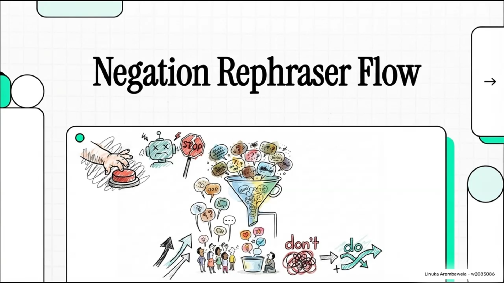

# Rephraser pre-processor

This small package contains a pilot `Constraint` datatype, a negation detector,
retrieval-based rephrasing, a deterministic generative rephraser, a similarity
verifier, and an end-to-end pipeline with latency instrumentation.

## Flow


## Demo video

[](https://youtu.be/Xpq4oY3GHPg)

Click the thumbnail to watch the demo video on YouTube.

Quick start:

1. Create a Python venv and install requirements:

```powershell
python -m venv .venv
.\.venv\Scripts\Activate.ps1
pip install -r requirements.txt
python -m spacy download en_core_web_sm
```

If you want the rephraser to call Gemini, also set your API key in PowerShell:

```powershell
$env:GEMINI_API_KEY = "your_api_key_here"
```

The Gemini-backed generator uses `google-generativeai` and falls back to the
local rewrite rules if the SDK or key is unavailable.

You can also place the key in `config/gemini.env`; the generator will load that
file automatically if `GEMINI_API_KEY` is not already present in the shell.

2. Run the pipeline from the CLI:

```powershell
python run_pipeline.py "Don't use jargon in the explanation."
```

3. Run a quick interactive check:

```python
from rephraser.detector import detect_negation
print(detect_negation("Don't use jargon in the explanation."))
```

Pipeline configuration lives in `config/pipeline_config.json`. The default
pipeline keeps a timing trace for `detect_negation`, candidate generation,
similarity scoring, and total runtime.
For this pilot, the similarity threshold is tuned to `0.6` so short
source-preserving affirmative rewrites are accepted instead of being rejected
as too dissimilar.

To switch to the generative rewrite path, change `generation_strategy` to
`generative` in `config/pipeline_config.json`.

The current rewrite templates prefer minimal source-preserving edits, so the
positive candidate keeps as much of the original sentence shape as possible.
